<p align="center">
  
</p>

<p align="center">
  
  
  
  
  
  
  
</p>

<p align="center">
  <a href="https://gram-drishti.vercel.app/"><b>Live demo</b></a> ·
  <a href="https://youtu.be/FH3spiMOgDQ"><b>Video</b></a>
  <br>
  <a href="#tuesday-gram-sabha-mulshi">The problem</a> ·
  <a href="#what-gramdrishti-does">What it does</a> ·
  <a href="#a-walk-through-the-app">Screens</a> ·
  <a href="#how-gramdrishti-thinks">How it thinks</a> ·
  <a href="#architecture">Architecture</a> ·
  <a href="#built-for-the-panchayat">Built for the Panchayat</a> ·
  <a href="#what-it-cannot-do-yet">Limits</a> ·
  <a href="#run-it">Run it</a>
</p>

---

## Tuesday, Gram Sabha, Mulshi

You are the sarpanch of a Gram Panchayat in Mulshi taluka, in the hills west of Pune. In two weeks the Gram Sabha meets to agree this year's Gram Panchayat Development Plan, the list of works the village will spend its grants on. Someone will ask for a new check dam. Someone else wants the money for the school road. The talathi says the well levels are down. Nobody in the room can say by how much, or since when.

The satellites already know. Sentinel-2 has photographed every field, tank and hillside in the taluka every five days for years. In GramDrishti's Mulshi scenario the village has lost a quarter of its surface water since 2022 (**156 ha to 119 ha**), vegetation vigour has slid from an NDVI of **0.61 to 0.48**, and tree cover is down from **28 % to 22 %** of the land. That is a water plan, not a road.

But the picture is locked behind band math, raster tiles and English-language GIS software. A Panchayat secretary has no time to learn Earth Engine, and a general chatbot asked "is Mulshi drying out?" will cheerfully invent a number.

**GramDrishti was built for that meeting.**

<sub>The scene is illustrative. Its numbers are the Mulshi demo preset that ships with the app (<code>backend/app/services/gee/processor.py</code>), a hand-built scenario for running offline, not a satellite measurement. With Earth Engine credentials the same screens show live values: the screenshots below are live, and live Mulshi currently scores a healthy 95.</sub>

### Why this is hard everywhere, not only in Mulshi

| Number | What it means |
|---|---|
| **6.4 lakh** | Villages in India, home to about **83 crore** people, 69 % of the country.<sup>[1]</sup> |
| **≈ 2.5 lakh** | Gram Panchayats, each preparing its own development plan every year.<sup>[2]</sup> |
| **every 5 days** | How often Sentinel-2 revisits every patch of land on Earth, free of charge.<sup>[3]</sup> |
| **0** | GIS analysts on the staff of a typical Gram Panchayat. |

The imagery stopped being the problem years ago. What is missing is the step between the picture and the Panchayat: **turning pixels into a few numbers a village can argue about, in its own language, with the evidence on the table**.

## What GramDrishti does

*Drishti* means sight. GramDrishti gives a village a way to see itself from orbit, and answers three questions for any village boundary:

1. **How healthy is this village right now?** One Village Health Score out of 100, built from five pillars: water, vegetation, climate, flood readiness and land use.
2. **What has changed, and how fast?** Every metric for each year from 2022 to 2026, with improving, stable or declining badges.
3. **What should the Panchayat do about it?** Prioritised actions and matching government schemes, explained in English, हिन्दी or मराठी, each tied to the numbers that triggered it.

The Panchayat gets **a briefing, not a heatmap**: a score, the evidence behind it, and a report it can print and carry to the district office.

### Three promises

- **The numbers come from code, not from the language model.** Indices, scores, trends, risk levels and scheme matches are computed by plain Python from Earth Engine and Open-Meteo responses. Gemini receives them as a structured JSON block and is told to use nothing else.
- **Missing data is said out loud.** If a value is not in the retrieved context, the answer says *"This information is currently unavailable"*. Every answer carries a confidence label computed from which data sources actually came back.
- **Every answer shows its working.** Answers follow *Summary → Evidence → Analysis → Recommendations → Confidence*, cite their sources (Google Earth Engine, Open-Meteo), and the raw retrieved data travels with the answer so the UI can draw it as charts and toggle the matching map layer.

## A walk through the app

Every screen below is a screenshot of the running app on live Google Earth Engine and Open-Meteo data for Mulshi taluka, Pune.

<p align="center">
  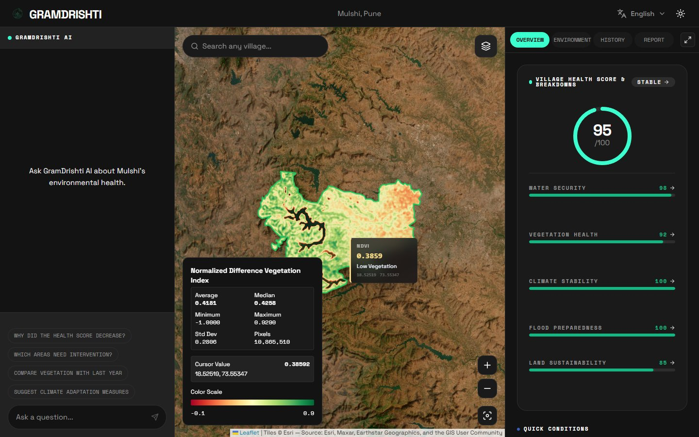
  <br><sub><b>A village, seen from orbit.</b> Mulshi under a 2024 Sentinel-2 NDVI composite: the reservoir in dark red, forested slopes in green, drier land to the east in orange. The panel gives the zonal statistics over 10.8 million pixels and the value under the cursor; the right column holds the Village Health Score and its five pillars.</sub>
</p>

<table>
<tr>
<td width="50%">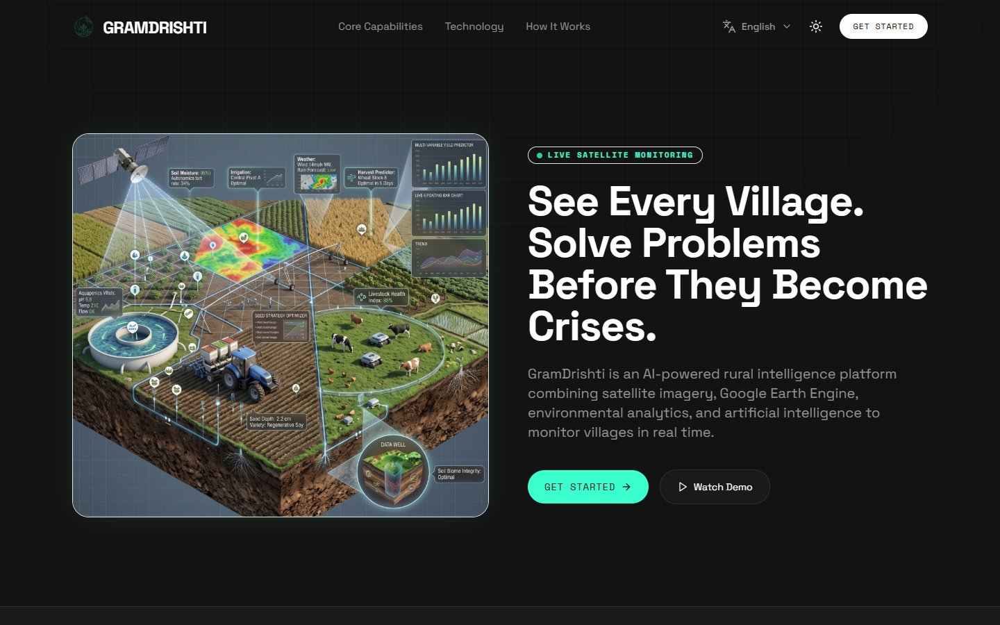<br><b>Landing.</b> What GramDrishti does and a way in.</td>
<td width="50%">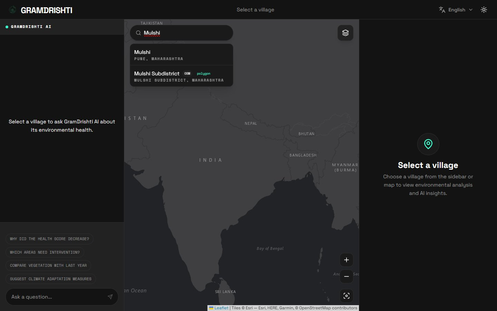<br><b>Find a village.</b> Bundled boundaries come first. Anything else falls through to OpenStreetMap, here the Mulshi subdistrict polygon, and is registered on the fly.</td>
</tr>
<tr>
<td>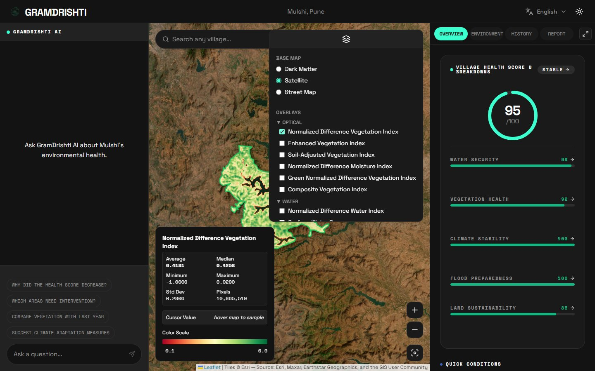<br><b>Layers.</b> Three basemaps and thirteen Earth Engine overlays: six vegetation and moisture indices and NDWI from Sentinel-2, JRC surface water, and five radar layers from Sentinel-1 that see through monsoon cloud.</td>
<td>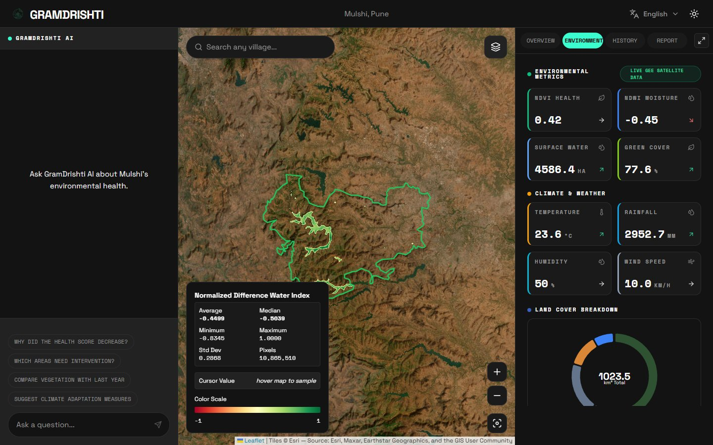<br><b>Environment.</b> The metrics behind the score: vegetation and water indices, surface water, green cover, weather from Open-Meteo, and the Dynamic World land cover breakdown.</td>
</tr>
<tr>
<td>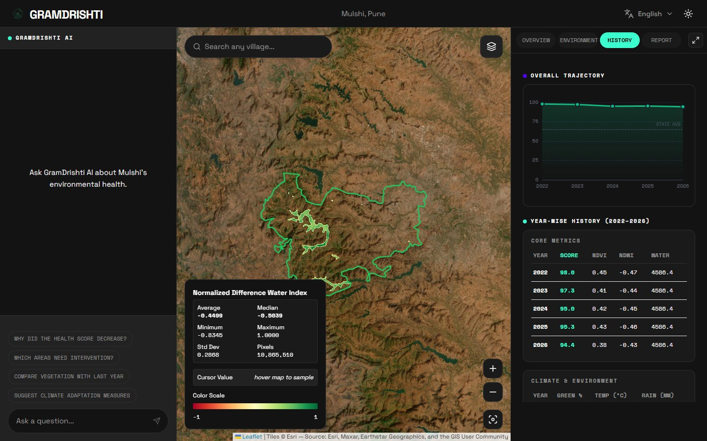<br><b>History.</b> The score's trajectory against the state average, and every core metric year by year from 2022 to 2026.</td>
<td>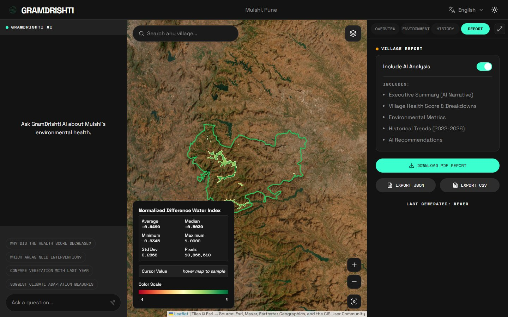<br><b>Report.</b> A PDF for the Gram Sabha or the block office, with or without the AI narrative, plus JSON and CSV exports.</td>
</tr>
<tr>
<td>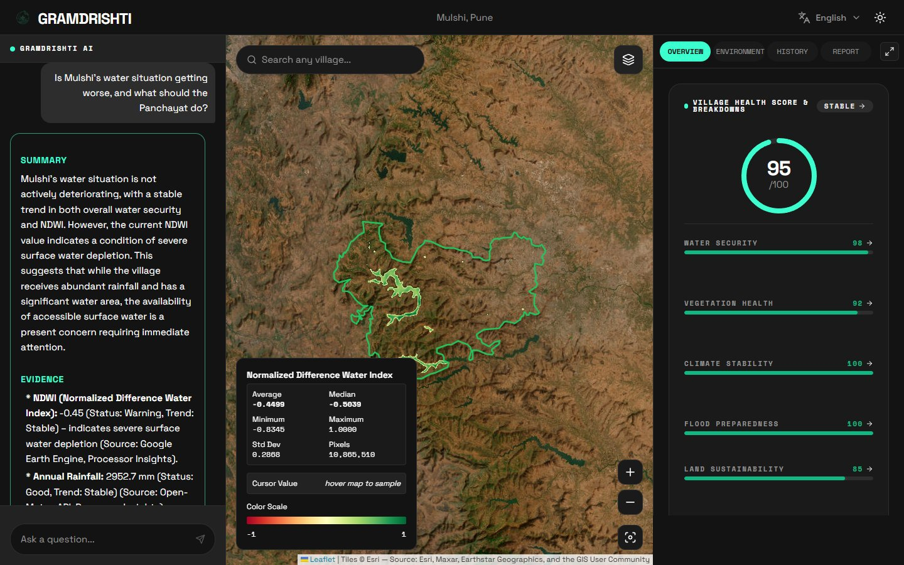<br><b>Ask GramDrishti.</b> "Is Mulshi's water situation getting worse, and what should the Panchayat do?" The answer starts with a summary, then the evidence, each value tagged with its source. The NDWI overlay behind it picks out the reservoir.</td>
<td>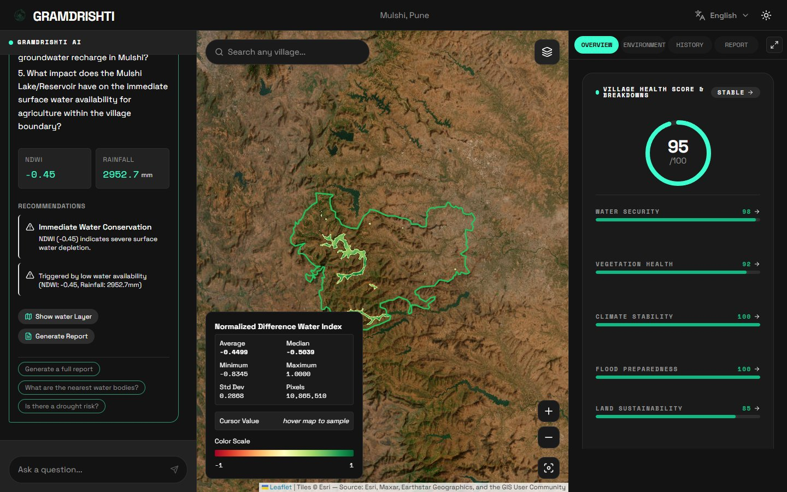<br><b>Evidence to action.</b> The same answer ends with a computed confidence label, the metrics it used, the processors' recommendations and scheme matches, buttons that switch the map layer or build a report, and follow-up questions.</td>
</tr>
</table>

<p align="center">
  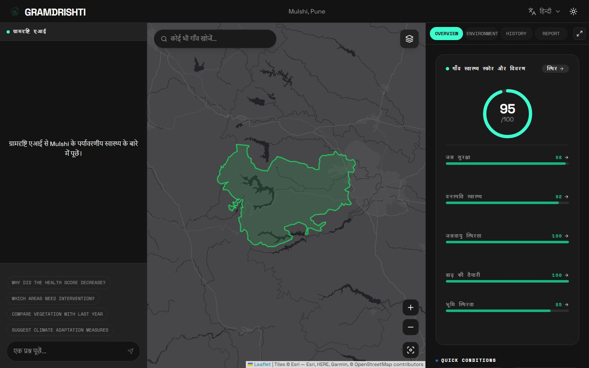
  <br><sub><b>हिन्दी, मराठी, English.</b> The interface switches language in one click, and AI answers follow it.</sub>
</p>

## How GramDrishti thinks

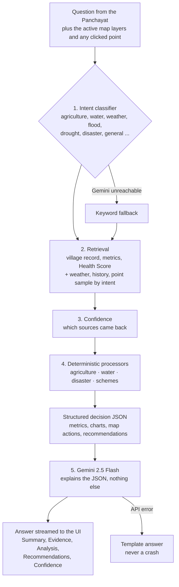

### The Village Health Score

Five pillars, each scored 0 to 100 and clamped so it can never leave that range (`backend/app/services/scoring/health_score.py`). The weights must sum to 1.0, and the code asserts that they do.

| Pillar | Weight | How it is scored |
|---|---:|---|
| 💧 Water security | 25 % | Surface water area (up to 40 pts) + NDWI (up to 30) + annual rainfall against 800 mm (up to 30) |
| 🌱 Vegetation health | 25 % | NDVI (up to 50) + green cover against 60 % (up to 30) + tree cover against 30 % (up to 20) |
| 🌤️ Climate stability | 20 % | Starts at 100; loses points for mean temperature over 40 °C, rainfall below 70 % of normal, heat stress, and drought risk |
| 🌊 Flood preparedness | 15 % | Starts at 100; loses points for flooded vegetation over 5 %, and heavy rain over flat terrain |
| 🌾 Land sustainability | 15 % | Starts at 100; loses points for bare land over 20 %, built area over 15 %, and very low cropland with little green cover |

A pillar is *improving* or *declining* when it moves more than 2 points against the previous year, and *stable* otherwise.

### Evidence first

Before the model writes a word, the retrieval engine (`backend/app/services/ai/retrieval_engine.py`) gathers only what the question needs, and tags every block with its source and date:

| Block | Fetched when | Source |
|---|---|---|
| Village record, metrics, Health Score | Always | Village database, Google Earth Engine, scoring engine |
| Current and annual weather | Weather, agriculture or water questions | Open-Meteo forecast and archive APIs |
| Four years of history | Agriculture, disaster or general questions | Historical metrics |
| Point sample | The user clicked the map | Earth Engine raster sample at that pixel |

Confidence is then computed, not guessed (`backend/app/services/ai/confidence.py`): **0.35 × GIS + 0.25 × weather + 0.20 × history + 0.20 × score**, labelled High at 0.8 or more, Medium at 0.5 or more, Low below.

### Processors, not prompts

Four small, testable functions (`backend/app/services/ai/processors/`) turn the evidence into decisions. Each returns metrics, charts, map actions and recommendations.

| Processor | Rule | What it produces |
|---|---|---|
| Agriculture | NDVI below 0.4, or falling more than 0.05 against the oldest year | *Soil moisture intervention* or *Investigate crop health trend*; an NDVI trend chart; switches the map to NDVI |
| Water | NDWI below 0.1, or annual rain under 500 mm | *Immediate water conservation* or *Rainwater harvesting check*; an NDWI trend chart; switches the map to water |
| Disaster | Flood score under 40 or rain over 1,500 mm is High; under 60 or over 1,000 mm is Medium | A flood risk level and, when High, a *Flood preparedness audit* |
| Schemes | NDWI below 0.15 or rain under 600 mm; NDVI below 0.4 | **PMKSY** (Pradhan Mantri Krishi Sinchayee Yojana) for water stress; **Soil Health Card** for poor vegetation, each with the reason it matched |

### Where the language model sits, and where it does not

- **It never computes a number.** Scores, indices, trends, risk levels and scheme matches all exist before the model is called.
- **It explains a JSON block.** The prompt (`backend/app/services/ai/prompt_builder.py`) puts the structured decision JSON, the active map layers and the clicked point in front of a fixed answer structure, and forbids inventing, estimating or inferring values.
- **It speaks the village's language.** The same JSON is explained in English, Hindi or Marathi on request.
- **It can fail safely.** If Gemini is unreachable the classifier falls back to keywords, and summaries, recommendations and report narratives fall back to templates. The app keeps working.

## Architecture

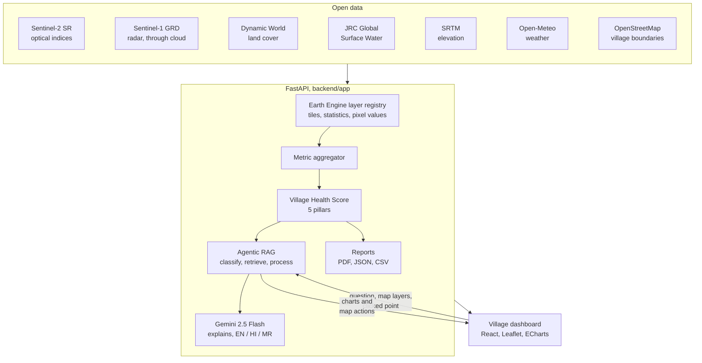

| Layer | Built with |
|---|---|
| Imagery and indices | Google Earth Engine: Sentinel-2 SR Harmonized, Sentinel-1 GRD, Dynamic World, JRC Global Surface Water, SRTM |
| Weather | Open-Meteo forecast and archive APIs |
| Boundaries and search | Bundled GeoJSON, with OpenStreetMap Nominatim for any other village |
| API | Python, FastAPI, Pydantic v2, GeoPandas, Shapely, an in-memory LRU cache with per-type TTLs |
| Decision logic | Plain Python scoring and processors |
| Language | Gemini 2.5 Flash over the REST API, with template fallbacks |
| Reports | ReportLab (PDF), plus JSON and CSV exporters |
| App | React 18, Vite, TypeScript, Tailwind CSS, React Leaflet, ECharts, Zustand, TanStack Query, i18next, Framer Motion |

## Built on open data

| What | Source |
|---|---|
| Optical indices | Copernicus **Sentinel-2 SR Harmonized** through Google Earth Engine, scenes filtered to under 20 % cloud by default. NDVI, EVI, SAVI, NDMI, GNDVI, NDWI and CVI. |
| Radar | Copernicus **Sentinel-1 GRD**: soil moisture index, radar vegetation index, VV/VH ratio and backscatter. Radar sees through monsoon cloud. |
| Land cover | Google **Dynamic World V1**: trees, crops, water, built area, grass, bare land, flooded vegetation, shrub. |
| Surface water | **JRC Global Surface Water** 1.4. |
| Terrain | **SRTM** 30 m elevation. |
| Weather | **Open-Meteo**: current conditions and annual rainfall and temperature from its archive. |
| Boundaries | Seven talukas bundled in `backend/data/maharashtra.geojson` (Mulshi, Maval, Ambegaon, Khed, Junnar, Shirur and Kolhapur), and **OpenStreetMap** through Nominatim for everything else. |

What is **assumed, and should be read that way**:

- **The offline demo is a scenario, not a measurement.** With `USE_MOCK_DATA=true`, five Pune talukas return hand-built yearly metrics so the app runs without Earth Engine. Each preset tells a different story:

  | Preset | Story, 2022 → 2026 |
  |---|---|
  | **Mulshi** | Steep decline: NDVI 0.61 → 0.48, surface water 156 → 119 ha |
  | **Maval** | Steady recovery: NDVI 0.55 → 0.62, water 89 → 102 ha |
  | **Ambegaon** | Slow drying: NDVI 0.58 → 0.54 |
  | **Khed** | Aridity: NDVI 0.52 → 0.45, bare land 8 % → 11 % |
  | **Junnar** | Ecological recovery: NDVI 0.59 → 0.63, tree cover rising |

- **Some score inputs are placeholders.** The water pillar assumes a 50 km² village when scaling surface water. The flood pillar assumes a 15 % flood-prone area and a 5° mean slope instead of reading them from SRTM. The climate pillar judges rainfall against a fixed 1,000 mm normal and drought against Pune district.

## Built for the Panchayat

GramDrishti starts with the Gram Panchayat because that is where decisions about water, land and works are made, and where the data has been hardest to reach.

- **The Panchayat is the user.** Sarpanch, Panchayat secretary, gram sevak, and the block and district officers who review their plans. Not a researcher with a GIS licence.
- **Villages and talukas, not bounding boxes.** Search by name. The boundary appears; the analysis runs on that polygon.
- **Schemes, not just scores.** A low NDWI is translated into *PMKSY applies here, and this is why*.
- **Monsoon cloud is normal.** Sentinel-1 radar layers keep working through the rainy season, when optical imagery is blank.
- **The Panchayat's language.** The interface and every AI answer are available in English, Hindi and Marathi.
- **Paper still matters.** The PDF report is designed to be printed and carried to the Gram Sabha or the block office.

**Where it could plug into India's public systems next.** These are directions, not partnerships:

| System | How GramDrishti could fit |
|---|---|
| **Gram Panchayat Development Plan** (eGramSwaraj) | Attach the Village Health Score and its evidence to the annual plan, so works are argued from data. |
| **MGNREGA** natural resource works | Point water-harvesting and plantation works at the villages and years where NDWI and tree cover are falling. |
| **PMKSY** and watershed programmes | A screen for which villages show sustained water stress before a field survey. |
| **District administration** | The same score across every village in a district, ranked, to decide where to send people and money first. |

## What it cannot do yet

- **10 m pixels, village averages.** Scores describe a whole boundary. They cannot see a single farm, well or check dam.
- **Placeholder score inputs.** Village area, flood-prone share, slope and the rainfall normal are fixed values (see above), so the water, flood and climate pillars are approximate until they are read from the data.
- **Surface water is not yearly yet.** The surface water area comes from JRC Global Surface Water, a long-term record, so it shows the same hectares in every year from 2022 to 2026. Year-on-year water change comes from NDWI.
- **Parts of the expanded workspace are placeholders.** Its data-source line, confidence percentage and part of its summary sentence are fixed text, not computed. The main dashboard tabs and the chat are computed.
- **Cold starts are slow.** The first live load of a new village can take around 45 seconds while Earth Engine computes over its polygon. `scripts/demo_setup.py` pre-warms the five presets.
- **The cache is in memory.** It is lost when the server restarts, and is not shared between workers.
- **Sign-in is local only.** The session lives in the browser. There are no server-side accounts or roles yet.
- **Farm boundaries are not connected.** The AgStack field-boundary provider is a stub awaiting a PostGIS database; `FARM_PROVIDER=mock` returns sample fields.
- **Scheme matching is narrow.** The deterministic engine matches PMKSY and the Soil Health Card. Other schemes appear only when the model mentions them.
- **No automated tests yet.** Verification is manual, through `backend/scripts/` and `backend/verify_gee.py`.

### Next

- Read flood-prone area and slope from SRTM, and village area from the boundary itself.
- PostgreSQL and PostGIS for villages, users and history; Redis for a shared cache.
- A district view that ranks every village.
- Alerts when a metric crosses a threshold, and scheduled refresh on each satellite pass.
- More schemes in the deterministic matcher, and more Indian languages.

The full roadmap is in [docs/FUTURE_SCOPE.md](docs/FUTURE_SCOPE.md).

## Run it

Requires Python 3.11 or newer and Node 20.19 or newer (for Vite 8).

On Windows, `run_all.bat` starts both servers in their own windows. Otherwise:

```bash
cd backend
python -m venv venv
venv\Scripts\activate          # macOS / Linux: source venv/bin/activate
pip install -r requirements.txt
cp .env.example .env           # then fill it in, or set USE_MOCK_DATA=true
python -m uvicorn main:app --reload --port 8000
```

In a second terminal:

```bash
cd frontend
npm install
cp .env.example .env
npm run dev
```

Open <http://localhost:5173>. The API docs are at <http://localhost:8000/docs>, and <http://localhost:8000/api/v1/health> reports whether Earth Engine is initialised or the app is in mock mode.

**No Earth Engine account?** Set `USE_MOCK_DATA=true` in `backend/.env` and search for Mulshi, Maval, Ambegaon, Khed or Junnar. The map, scores, history and reports all work offline; the AI answers still need `GEMINI_API_KEY`, and fall back to templates without it.

**With Earth Engine**, put a service-account key at `backend/credentials/gee_credentials.json`, set `GEE_PROJECT_ID` and `GEE_SERVICE_ACCOUNT_EMAIL`, and check the connection with:

```bash
python backend/verify_gee.py
```

Before a live demo, warm the cache so each preset loads in under two seconds:

```bash
python scripts/demo_setup.py
```

## Reference

<details>
<summary><b>Configuration</b></summary>

`backend/.env` (see `backend/.env.example`):

| Variable | Default | Effect |
|---|---|---|
| `GEE_PROJECT_ID` | none | Earth Engine cloud project. |
| `GEE_SERVICE_ACCOUNT_EMAIL` | none | The service account that owns the key. |
| `GEE_CREDENTIALS_PATH` | `./credentials/gee_credentials.json` | Path to the service-account JSON key, relative to `backend/`. |
| `GEMINI_API_KEY` | none | Lets Gemini classify questions and write answers, summaries and report narratives. Without it, keyword classification and templates are used. |
| `OPENMETEO_BASE_URL` | `https://api.open-meteo.com/v1` | Open-Meteo forecast endpoint. |
| `ALLOWED_ORIGINS` | `http://localhost:5173,...` | Comma-separated CORS origins. |
| `USE_MOCK_DATA` | `false` | `true` skips Earth Engine and serves the five Pune presets. |
| `DEMO_MODE`, `DEMO_TOKEN` | `false`, none | Reserved for letting requests with a matching `X-Demo-Token` header skip rate limits. Not wired in yet: the AI routes allow 10 requests a minute per IP regardless. |
| `FARM_PROVIDER` | `agstack` | `agstack` or `mock`, for farm boundaries inside a village. |
| `DEBUG` | `true` | Verbose logging. |

`frontend/.env`:

| Variable | Default | Effect |
|---|---|---|
| `VITE_API_BASE_URL` | `http://localhost:8000` | Where the dashboard finds the API. |

</details>

<details>
<summary><b>API</b></summary>

Every route is under `/api/v1`. The interactive docs at `/docs` list every parameter.

| Route | Purpose |
|---|---|
| `GET /health` | Earth Engine status and mock mode |
| `GET /villages/search`; `POST /villages/register` | Search bundled villages; register a boundary found through OpenStreetMap |
| `GET /villages/{id}`, `/villages/{id}/boundary`, `/villages/boundaries/all` | Village records and their GeoJSON |
| `GET /satellite/layers`, `/satellite/tiles`, `/satellite/statistics`, `/satellite/value`, `/satellite/compare`, `/satellite/export` | The Earth Engine layer registry: map tiles, zonal statistics, pixel values, comparisons |
| `GET /satellite/{id}/metrics`, `/ndvi`, `/water`, `/landcover`, `/terrain` and their `/tiles` | Per-village satellite metrics and overlays |
| `GET /scores/{id}`, `/scores/{id}/component/{component}`, `/scores/{id}/trend`; `POST /scores/analyze` | The Village Health Score |
| `GET /history/{id}`, `/history/{id}/changes`, `/history/{id}/compare` | Metrics from 2022 to 2026 and change detection |
| `GET /weather/{id}/current`, `/historical`, `/assessment` | Open-Meteo weather and heat and drought assessment |
| `GET /analysis/{id}/environmental`, `/analysis/{id}/summary`; `POST /analyze` | Environmental analysis |
| `GET /recommendations/{id}`, `/recommendations/{id}/risks`; `POST /recommendations/analyze` | Recommendations and ranked risks |
| `POST /ai/{id}/chat` | Ask GramDrishti: a streamed answer with status updates, structured data and follow-up questions |
| `POST /ai/{id}/summary`, `/ai/{id}/recommendations`; `GET /ai/{id}/report-narrative` | AI summaries, recommendations and report text |
| `GET /reports/{id}/pdf`, `/json`, `/csv` | Downloadable reports |
| `GET /villages/{id}/farms` | Farm boundaries inside a village |

</details>

<details>
<summary><b>Project layout</b></summary>

```
backend/main.py             FastAPI app, CORS, startup (load villages, initialise Earth Engine)
backend/app/api/routes      health, villages, satellite, scores, history, weather, analysis,
                            recommendations, ai, reports, farms
backend/app/services/gee    Earth Engine auth, layer registry, Sentinel-1/2, Dynamic World, water, terrain
backend/app/services/scoring  Health Score, aggregator, history, risk ranker
backend/app/services/ai     classifier, retrieval engine, confidence, processors/, prompt builder,
                            Gemini client, audit log
backend/app/services/reports  PDF, JSON and CSV exporters
backend/app/services/weather  Open-Meteo client and heat and drought assessment
backend/data                bundled taluka boundaries (GeoJSON)
backend/scripts             manual checks: API smoke test, raster verification
frontend/src/pages          landing, sign-in
frontend/src/components     map/, dashboard/, workspace/, ai/, charts/, landing/, layout/
frontend/src/hooks          useAIChat (streaming chat), useVillageSelection, useScores, ...
frontend/src/locales        en, hi, mr
scripts/                    demo_setup.py (cache warm-up), fetch_real_boundaries.py
docs/                       ARCHITECTURE, DOCUMENTATION, PROJECT_WORKFLOW, DEMO_GUIDE, FUTURE_SCOPE
```

More detail: [docs/ARCHITECTURE.md](docs/ARCHITECTURE.md) · [docs/DOCUMENTATION.md](docs/DOCUMENTATION.md) · [docs/PROJECT_WORKFLOW.md](docs/PROJECT_WORKFLOW.md) · [docs/DEMO_GUIDE.md](docs/DEMO_GUIDE.md) · [CONTRIBUTING.md](CONTRIBUTING.md) · [CHANGELOG.md](CHANGELOG.md)

</details>

## Sources

**The problem**

1. Census of India 2011: 6,40,867 villages; rural population 83.3 crore, 68.8 % of the total. Office of the Registrar General and Census Commissioner, India. <https://censusindia.gov.in>
2. Ministry of Panchayati Raj, Government of India: Gram Panchayats and the Gram Panchayat Development Plan, through eGramSwaraj. <https://egramswaraj.gov.in>
3. European Space Agency, Sentinel-2 mission: a five-day revisit at the equator with two satellites. <https://www.esa.int/Applications/Observing_the_Earth/Copernicus/Sentinel-2>

**Data and licences**

- **Imagery:** contains modified Copernicus Sentinel-1 and Sentinel-2 data, through Google Earth Engine.
- **Land cover:** Dynamic World V1, Google and World Resources Institute (CC-BY-4.0).
- **Surface water:** JRC Global Surface Water, European Commission Joint Research Centre.
- **Elevation:** SRTM, NASA and USGS.
- **Weather:** Open-Meteo (CC-BY-4.0).
- **Boundaries and search:** OpenStreetMap contributors (ODbL), through Nominatim.

<p align="center"><br><sub><b>GramDrishti</b> · ग्रामदृष्टि · See your village the way the satellites do.</sub><br><sub>Built for the Build for Good Hackathon 2026 · MIT licence</sub></p>
